# Café Ops Manager

Expense tracking, cash reconciliation, HACCP checklists and invoice import for a small Italian bar, built on Google Sheets. Zero cost, works on a very old iPad.

| Home | Monthly summary |
|---|---|
| 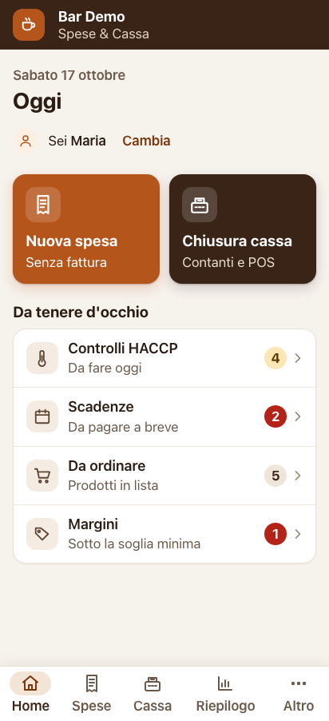 | 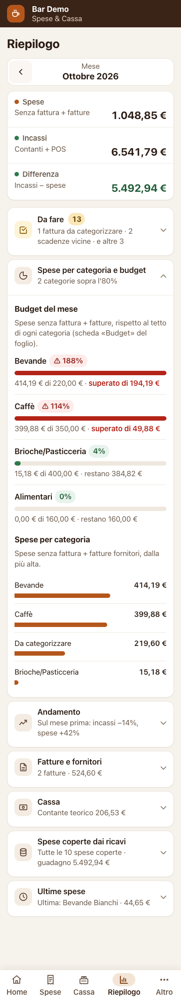 |

## Why I built it

Built for my mother's bar after seeing paper-only bookkeeping: closings and purchases on a sheet of paper, supplier invoices as XML files on the tax portal, deadlines remembered by heart.
The only devices were two Android phones and an iPad too old for modern web apps, and paid software was out of the question.

> **Portfolio edition.** The venue name, suppliers, people, amounts, invoices and screenshots are all invented ("Bar Demo"). The original deployment is private.

## Features

- **Expenses and cash closing with reconciliation**: expenses without invoice (date, amount, supplier with type-ahead search, category, payment method, note, optional "pay by" date, receipt photo compressed on the phone before upload to Drive); one cash closing per day with cash, card and float, optional total from the fiscal register with an immediate green / amber / red verdict, mandatory note beyond the tolerance, difference tracked in the summary and the report.
- **Expenses covered by takings**: answers "do the till takings pay for the expenses?". Day by day, each closing's takings cover the oldest open expense first, then the next; any surplus carries forward. Per month, quarter, year or custom dates, filterable to invoices or cash expenses; every expense shows the takings that cover it and a red "still to cover" or green "covered ✓" ribbon, plus a per-month summary for long periods. Amounts are computed in cents, so no rounding drift.
- **HACCP log**: today's checks (fridge and freezer temperatures, cleaning, expiry checks), corrective action for out-of-range temperatures, email reminders and a **monthly PDF register**. Default checks are examples only.
- **Budget per category**: monthly caps, progress bars, email alerts at 80% and 100%.
- **Deadlines**: generated from invoices, recurring costs (rent, utilities, taxes) and dated expenses; email reminders; "mark as paid" from the phone; ready-made venue deadlines (extinguishers, coffee machine service, insurance, licences) to switch on.
- **Electronic invoice import (XML / CSV)**: drop the files downloaded from the tax portal into a Drive folder; the app parses **XML, P7M (signed), ZIP** and the portal's **CSV export**, deduplicates by VAT number + invoice number + date, handles credit notes and multiple VAT rates, and asks you to categorise new suppliers.
- **Monthly report by email** on the 1st: expenses, invoices, takings, reconciliation, budget, comparisons with the previous month and the same month last year, Excel attachment.
- **Offline queue**: expenses and closings are stored on the device when the network is gone and sent automatically when it is back, with client-generated IDs so nothing is saved twice.
- **Quick add to the order list, with singular / plural units**: a **+ Prodotto** button on each supplier card opens a type-ahead field; tapping a suggestion adds it with quantity 1 and keeps the field open for the next one, tapping again bumps the quantity, unknown names become new products for that supplier, most-ordered products (per device) come first. Units read "1 cassa" but "3 casse", also in the pre-written WhatsApp order; abbreviations (kg, l, pz…) never change and an optional "Unità plurale" column overrides the rule.
- **Bottom navigation bar**: five tabs (Home, Expenses, Cash, Summary, More), a daily Home with the two main actions and a "keep an eye on" list, consistent cards, pills and segmented controls; the rules live in `docs/DESIGN.md`.
- Also: supplier balances, cash deposits and withdrawals with theoretical cash on hand, product cost and margin, "who entered this", search and edit, weekly backup, error log and support email.

### More screenshots

| New expense | Cash closing with reconciliation | Expenses covered by takings |
|---|---|---|
| 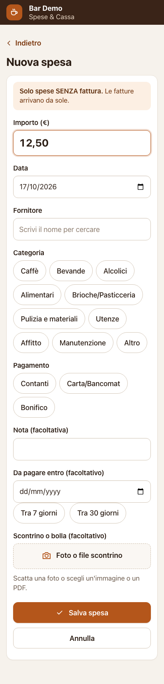 | 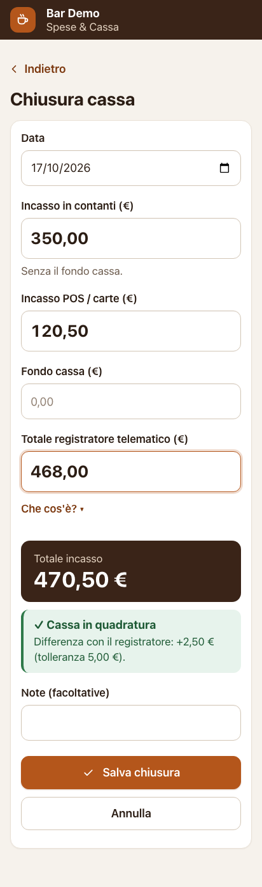 | 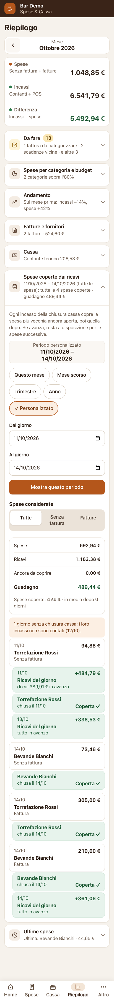 |

| Expenses list and filters | Offline queue | HACCP daily checks |
|---|---|---|
| 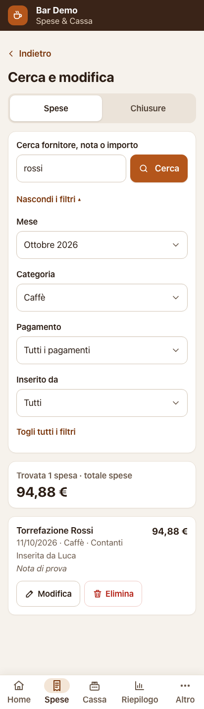 | 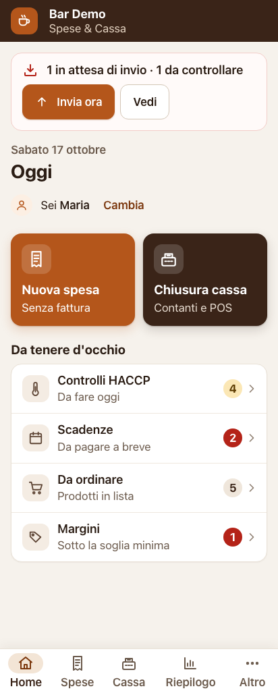 | 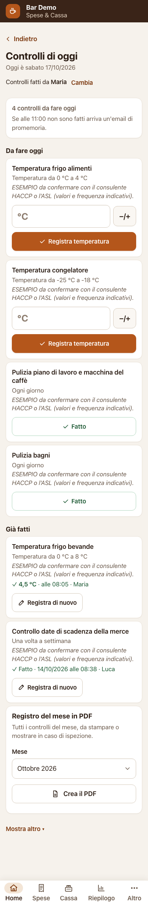 |

| Deadlines | Suppliers | Quick add to the order list |
|---|---|---|
| 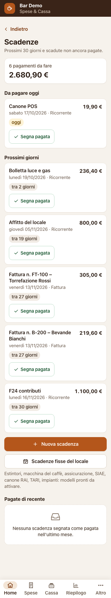 | 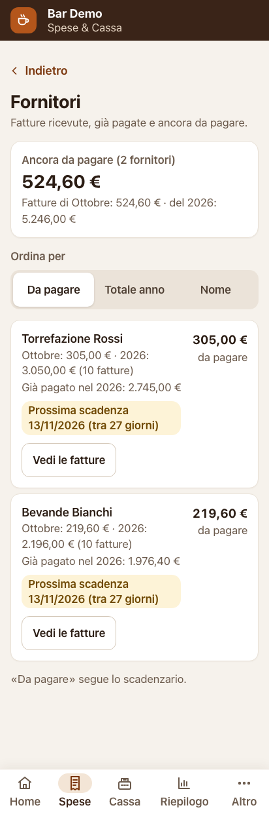 | 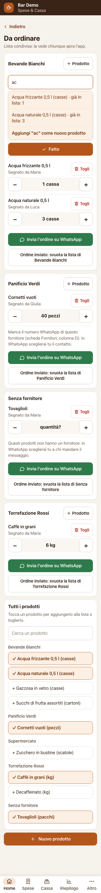 |

Tablet layout (1024 px):

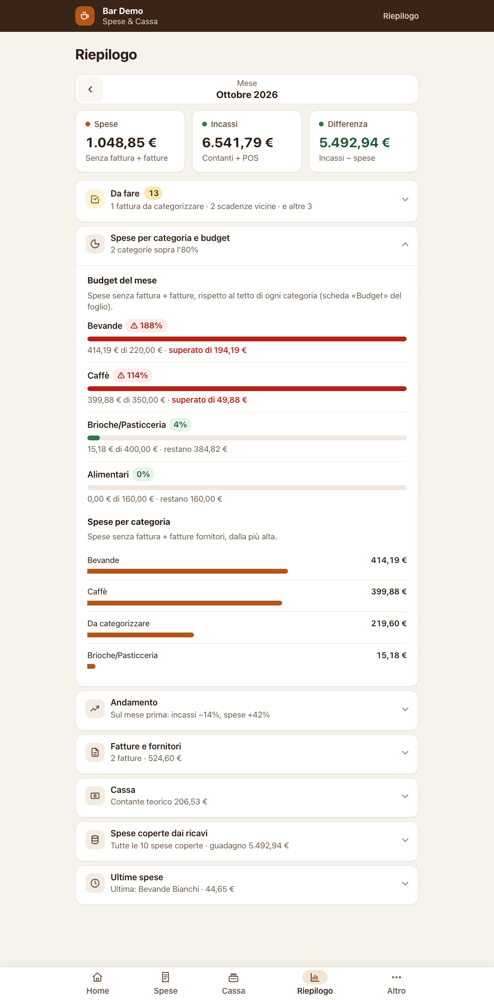

## Stack and technical choices

| Choice | Why |
|---|---|
| **Google Apps Script** web app + **Google Sheet** as database + **Drive** for files | Free, no server, the owner already had a Google account, data stays in their Drive and is readable without the app |
| Plain **ES5** JavaScript, no framework, no build step | Must run on an old iPad's Safari; a static check (`prove/controllo-client.js`, acorn in ES5 mode) fails the test suite on any ES6 syntax |
| CSS without flexbox, grid, custom properties, `calc`, `gap`, `clamp`, `sticky` | Same device constraint; layout uses `display: table`, `inline-block` and `position: fixed`; the same check rejects forbidden CSS |
| Large text (≥ 17 px) and tall buttons (≥ 52 px), bottom navigation with five tabs | Staff use it in a hurry, often with wet hands; see the design system in `docs/DESIGN.md` |
| **Fake Apps Script runtime** for tests (`prove/gas-finto.js`) | In-memory `SpreadsheetApp`, `DriveApp`, `MailApp`, `Utilities`, `XmlService`, `HtmlService`, `LockService`… so the same `.gs` code runs under Node and in CI |
| Browser tests and screenshots with Playwright at 320 / 412 / 1024 px | Checks that no text overflows its box and that buttons keep the minimum size |
| Client-generated IDs, `LockService` on writes, idempotent server calls | Several phones write to the same sheet; retries from the offline queue must never duplicate rows |
| Secrets only in the sheet's *Impostazioni* tab | Email addresses, PIN and folder IDs never enter the repository |
| One-command deploy with `clasp` (`npm run deploy`) | Keeps the same web-app URL across versions |

### Repository layout

```
Code.gs, Elenco.gs, Copertura.gs, … server side (Apps Script)
Index.html, Script.html, Stile.html  the single-page client (ES5 + plain CSS)
Test*.gs                             test functions runnable from the Apps Script editor
prove/                               fake Apps Script runtime, Node and browser tests, screenshots
esempi/                              invented sample invoices (XML and portal CSV)
strumenti/aggiorna-app.js            clasp deploy helper
docs/                                design system and screenshots
README_IT.md                         full installation and user guide (Italian)
NOTE_SVILUPPO.md                     development notes (Italian)
```

### Running the tests

```bash
npm install
npm test             # ES5/CSS check, Test*.gs functions, Node + browser tests
npm run server-finto # local demo at http://localhost:8080 (PIN 1234)
npm run screenshot   # regenerates prove/screenshot/*.png and checks text overflow
```

Browser tests need Chromium via Playwright (`npm i -g playwright && npx playwright install chromium`).

## Installation

The step-by-step guide (creating the sheet, pasting the code, authorising, publishing, importing invoices, daily use) is in **[README_IT.md](README_IT.md)** (Italian).

## Disclaimer

> ⚠️ The default **HACCP checks are demo content only** and must be confirmed with the local health authority (ASL) or an HACCP consultant. Nothing in this project is **tax or accounting advice**: VAT, deadlines and filings are for your accountant.

## License

MIT – Copyright (c) 2026 Mattia. See [LICENSE](LICENSE).
